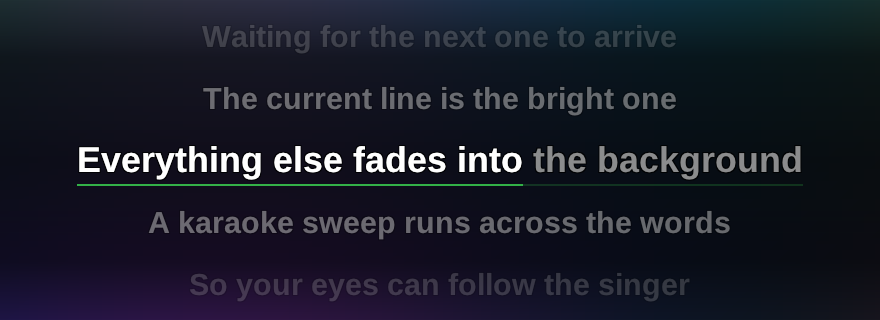

# LINYRICS

**Linyrics** adalah jendela lirik melayang untuk **[Linamp](https://github.com/adiprnm/linamp)** — pengganti MiniLyrics
untuk Linux: begitu lagu diputar di Linamp, liriknya muncul sendiri di atas desktop,
baris yang sedang dinyanyikan menyala dengan sapuan karaoke, dan baris berikutnya
sudah menunggu di bawahnya.

Tampilannya sengaja dibuat semirip mungkin dengan MiniLyrics: huruf **Arial Bold
putih dengan outline hitam** (jadi tetap terbaca di wallpaper terang), beberapa
baris sekaligus dengan baris aktif paling terang, sisanya meredup ke atas dan ke
bawah.



*Screenshot memakai background gradient agar area transparan terlihat — di desktop,
hanya teks lirik dan sapuan karaokenya yang tampil.*

## Fitur

- **Otomatis.** Tidak perlu menekan apa pun: Linyrics mengikuti lagu yang sedang
  diputar Linamp, termasuk saat pause, seek, ganti track, dan ganti playlist.
- **Efek karaoke.** Baris aktif di tengah, kata yang sudah dinyanyikan berwarna
  penuh, sisanya redup, plus progress bar tipis di bawah baris aktif. Kalau file
  LRC-nya menyimpan waktu per kata (enhanced LRC), sapuannya mengikuti tiap kata;
  kalau tidak, per baris.
- **Gaya MiniLyrics.** Font Arial-class bold (Liberation Sans Bold / Arimo Bold —
  pengganti Arial di Linux) dengan outline hitam yang di-dilate sekali per glyph,
  jadi tidak ada biaya render per frame. Ukuran baris hampir seragam; terangnya
  yang membedakan baris aktif dari yang lain.
- **Scroll halus.** Baris bergulir dengan easing, ukuran huruf mengecil sedikit dan
  memudar sesuai jarak dari baris aktif — bukan highlight yang melompat-lompat.
- **Sumber lirik berlapis.** `.lrc` di sebelah file audio → cache lokal → LRCLIB
  (lrclib.net, gratis, tanpa API key). Hasil unduhan disimpan, jadi lagu yang sama
  tidak perlu diunduh dua kali.
- **Jendela transparan & frameless** seperti panel Winamp-nya Linamp. Bisa digeser
  ke mana saja, punya mode background *none / dim / dark*.
- **Kecil.** Binary build lokal ±430 KB (libcurl dari sistem). Di paket rilis
  libcurl di-link statis supaya tidak perlu membundel dependency-nya:
  AppImage ±4,7 MB, `linyrics.exe` ±6 MB (zip ±2,5 MB), dmg macOS ±1,7 MB. Tidak ada Electron, dan font diambil dari
  sistem saat runtime.

## Cara kerja

```
Linamp  ──tulis 10×/detik──▶  $XDG_RUNTIME_DIR/linamp/nowplaying.json
                                     │  (judul, artis, path, posisi, playing, seq,
                                     │   + stempel CLOCK_MONOTONIC)
                                     ▼
                              Linyrics (poll 70 ms)
                                     │  posisi = position + (mono_sekarang − mono_snapshot)
                                     │
                     ┌───────────────┴───────────────┐
                     ▼                               ▼
        <lagu>.lrc → cache lokal          LRCLIB /api/get → /api/search
                                     │
                                     ▼
                          render: baris aktif + sapuan karaoke
```

Linamp menulis posisi **dan** stempel `CLOCK_MONOTONIC` pada saat yang sama; karena
jam itu sama di semua proses, Linyrics bisa menghitung posisi playback secara tepat
di antara dua update, bukan menebak dari interval polling. Itu yang membuat sapuan
karaoke tetap rapat dengan suaranya (± beberapa milidetik) walaupun update-nya cuma
10 kali per detik.

Sisi Linamp-nya kecil: `src/nowplaying.h` / `src/nowplaying.cpp` (sekitar 100 baris),
dipanggil sekali per frame dari `App::frame()`.

## Unduh

Ambil dari [**Releases**](https://github.com/adiprnm/linyrics/releases):

| Platform | File | Catatan |
| --- | --- | --- |
| Linux x86_64 | `linyrics-linux-x86_64.AppImage` (±4,8 MB) | glibc 2.39+; SDL3 dibundel, libcurl statis |
| Windows x64 | `linyrics-windows-x64.zip` (±2,5 MB) | satu `linyrics.exe`, tanpa DLL |
| macOS arm64 | `linyrics-macos-arm64.dmg` (±1,7 MB) | ad-hoc signed; klik kanan → Open |

Butuh **Linamp 2.1.0+** — versi lama tidak menulis `nowplaying.json`, jadi lirik
akan tampil tapi tidak bergerak.

## Build & jalankan

Butuh SDL3, libcurl, dan compiler C++20 (Arch/Omarchy):

```bash
sudo pacman -S --needed sdl3 curl pkgconf gcc make

./run.sh            # build kalau perlu, lalu jalankan
./run.sh --toggle   # sembunyikan / tampilkan window yang sedang jalan
./run.sh --quit     # matikan
```

Pasang launcher aplikasi + icon + symlink `~/.local/bin`:

```bash
./install-desktop.sh
```

Lalu jalankan **Linamp**, putar lagu, dan jalankan **Linyrics** (atau dari launcher).

### Perintah

| Perintah | Fungsi |
| --- | --- |
| `linyrics` | Jalankan. Kalau sudah jalan, malah men-toggle window (tidak pernah ada dua instance). |
| `linyrics --toggle` | Tampilkan / sembunyikan window (cocok untuk keybinding). |
| `linyrics --quit` | Hentikan proses. |
| `linyrics --version` / `--help` | Info. |

### Build rilis (CMake, libcurl statis)

Build yang dipakai CI: SDL3 **shared** (dibundel ke AppImage) + libcurl **statis**
supaya OpenSSL dan kawan-kawan tidak ikut masuk paket.

```bash
./packaging/build-sdl3.sh "$PWD/deps/sdl3" shared   # SDL3
./packaging/build-curl.sh "$PWD/deps/curl"          # libcurl statis, HTTPS saja

cmake -S . -B build-cmake -G Ninja -DCMAKE_BUILD_TYPE=Release \
      -DCMAKE_PREFIX_PATH="$PWD/deps/sdl3" \
      -DCURL_ROOT="$PWD/deps/curl"
cmake --build build-cmake
./build-cmake/linyrics
```

Paket AppImage:

```bash
./packaging/make-appimage.sh ./build-cmake/linyrics "$PWD/deps/sdl3" linyrics.AppImage
```

Tanpa `-DCURL_ROOT`, CMake memakai libcurl dev package dari distro (cukup untuk
build lokal, tapi jangan untuk AppImage karena dependency-nya jadi banyak).

## Keyboard & mouse

| Aksi | Fungsi |
| --- | --- |
| Klik kanan / `M` | Menu (reload, buka `.lrc`, delay, ukuran teks, background, settings) |
| `↑` / `↓` + `Enter` | Navigasi menu tanpa mouse (saat menu terbuka) |
| Drag & drop file `.lrc` ke window | Pakai lirik itu (disimpan ke cache) |
| Drag di mana saja | Geser window |
| Drag pojok kanan-bawah | Ubah ukuran window |
| `←` / `→` | Delay lirik −0.25 s / +0.25 s (`Shift` = 2 s) |
| `↑` / `↓` | Ukuran teks (menu tertutup) |
| `Ctrl` + scroll | Delay (tanpa `Ctrl` = ukuran teks) |
| `R` | Cari ulang lirik (paksa online) |
| `Ctrl+0` | Reset delay |
| `Esc` | Tutup menu / sembunyikan window |
| `Ctrl+Q` | Keluar |

Kalau lirik terasa maju atau mundur, koreksi dengan `←`/`→`; nilainya disimpan
per aplikasi (bukan per lagu) dan dipakai untuk semua lagu.

## Konfigurasi

`~/.config/linyrics/config.json` — dibuat otomatis saat pertama kali berubah:

| Key | Default | Arti |
| --- | --- | --- |
| `width`, `height` | `880`, `320` | Ukuran window (juga tersimpan saat di-resize) |
| `fontPx` | `40` | Ukuran baris aktif; baris lain otomatis sedikit lebih kecil |
| `delayMs` | `0` | Koreksi waktu global (+ = lirik muncul lebih lambat) |
| `bg` | `"dim"` | `none` (full transparan — hanya teks + outline hitam), `dim` (gradasi gelap), `dark` (panel) |
| `bgOpacity` | `0.72` | Kekuatan background |
| `online` | `true` | Boleh cari ke LRCLIB |
| `underline` | `true` | Progress bar karaoke di bawah baris aktif |
| `alwaysOnTop` | `true` | Selalu di atas window lain |
| `hideWhenIdle` | `true` | Sembunyikan window kalau 5 detik tidak ada lagu (proses tetap jalan, muncul lagi otomatis saat lagu diputar). Set `false` kalau mau window selalu terlihat |
| `font` | — | Path TTF/OTF/TTC sendiri (mis. `~/.local/share/fonts/Foo.ttf`) |

Font dipilih otomatis, urutannya: `font` di config → `$LINYRICS_FONT` →
Arial Bold / Tahoma Bold (Windows-nya MiniLyrics) → Liberation Sans Bold / Arimo
Bold (klon Arial di Linux) → DejaVu/Noto Sans. Mau gaya lain? Set `font` ke path
TTF/OTF/TTC, misalnya font Figtree di `~/.local/share/fonts/`.

Untuk aksara yang tidak ada di font utama, Linyrics memuat font fallback
(Noto Sans CJK) **hanya saat dibutuhkan** — jadi lirik Jepang/Korea/Arab tetap
tampil tanpa membebani startup lagu berbahasa Latin.

Cache lirik: `~/.cache/linyrics/lyrics/<artis> - <judul>.lrc`.

Catatan `bg`:

- `none` = jendela benar-benar transparan; hanya huruf yang tampil. Outline hitam
  otomatis dibuat lebih tebal supaya tetap terbaca. Di wallpaper yang sangat
  terang hasilnya tetap kurang kontras — pakai `dim` kalau butuh jaminan terbaca.
- Ganti lewat klik kanan → **Background** (berputar `dim → dark → none`), atau
  edit `config.json` **saat Linyrics tidak berjalan**: config ditulis ulang dari
  memori saat keluar, jadi perubahan manual saat app jalan akan tertimpa.
- Area transparan tetap milik window (klik di situ tidak menembus ke desktop).
  Kalau mengganggu, set `hideWhenIdle: true` atau kecilkan window.

## Supaya selalu melayang (Hyprland / Omarchy)

Aturan di `~/.config/hypr/hyprland.lua` (gaya Omarchy 4):

```lua
-- Linyrics: lirik melayang di atas, tanpa border/shadow/blur, tidak ambil fokus.
o.window({ class = "^[lL]inyrics$" }, {
    float = true,
    size = { 880, 320 },
    move = "50% 5%",
    no_initial_focus = true,
    border_size = 0,
    rounding = 0,
    no_shadow = true,
    no_blur = true,
    tag = "-default-opacity",
    opacity = "1.0 override 1.0 override"
})
```

Padanan `hyprland.conf`:

```ini
windowrulev2 = float,class:^(linyrics)$
windowrulev2 = noinitialfocus,class:^(linyrics)$
windowrulev2 = noborder,class:^(linyrics)$
windowrulev2 = noshadow,class:^(linyrics)$
windowrulev2 = noblur,class:^(linyrics)$
windowrulev2 = move 50% 5%,class:^(linyrics)$
```

`no_initial_focus` penting: window lirik tidak boleh merebut fokus dari Linamp,
jadi `Space`/`Z`/`B` tetap mengontrol pemutar saat lirik muncul.

Catatan `pin`: menambahkan `pin = true` (atau `windowrulev2 = pin,…`) membuat window
lirik ikut terlihat di **semua** workspace. Tanpa `pin`, lirik tetap di workspace
tempat ia dibuka — pindah workspace berarti liriknya tertinggal. Pilih sesuai
selera; default di sini tidak di-pin.

Autostart di `~/.config/hypr/autostart.lua`:

```lua
o.launch_on_start("linyrics")
```

Keybinding untuk show/hide (contoh `hyprland.conf`):

```ini
bind = SUPER, L, exec, linyrics --toggle
```

## Dev helper

```bash
# render satu frame ke BMP tanpa layar (juga dipakai untuk cek tampilan)
SDL_VIDEODRIVER=dummy LINYRICS_SCREENSHOT=/tmp/shot.bmp \
  LINYRICS_SCENE=playing LINYRICS_POS=12.2 ./build/linyrics

# scene: playing | cjk | idle | none | menu | menu2 | live
# "live" mengikuti nowplaying.json yang asli (uji alur Linamp → LRCLIB)

# ukuran teks / HiDPI emulation
LINYRICS_PIXEL_SCALE=1.25 ...

# log state tiap 0,5 detik (posisi, index baris aktif, status, sumber lirik)
LINYRICS_DEBUG=1 ./run.sh
```

Self test menu (headless, tanpa input asli):

```bash
SDL_VIDEODRIVER=dummy LINYRICS_TEST=1 ./build/linyrics   # semua harus PASS
```

Unit test parser LRC:

```bash
g++ -std=c++20 -O1 -o /tmp/parse_test tests/parse_test.cpp src/lyrics.cpp -Isrc && /tmp/parse_test
```

## Troubleshooting

**Window-nya hilang setelah beberapa detik, apakah crash?**
Bukan. Selama belum ada lagu yang diputar, Linyrics menyembunyikan window-nya
setelah 5 detik supaya tidak menutupi desktop dan tidak menelan klik. Prosesnya
tetap jalan:

```bash
pgrep -a linyrics      # masih ada? berarti hidup
linyrics --toggle      # munculkan lagi (proses tetap jalan)
```

Window muncul lagi otomatis begitu Linamp mulai memutar lagu. Kalau mau window
selalu kelihatan (menampilkan "waiting for linamp"), set `"hideWhenIdle": false`
di `~/.config/linyrics/config.json`.

**Lirik tampil tapi tidak berjalan (diam di baris pertama)**
Berarti tidak ada data posisi dari Linamp. Cek:

```bash
cat "$XDG_RUNTIME_DIR/linamp/nowplaying.json"   # harus ada & berubah tiap detik
ps -o lstart= -p "$(pgrep linamp)"              # kapan proses Linamp dijalankan?
```

Kalau file itu tidak ada atau isinya tidak berubah: **restart Linamp** (Ctrl+Q,
lalu buka lagi). Proses Linamp yang dijalankan sebelum fitur publisher ada
(atau sebelum binary-nya di-rebuild) tidak akan menulis file itu. Di jendela
Linyrics sendiri akan muncul peringatan kuning kalau ini terjadi.

**Lirik tidak muncul padahal lagu jalan**
Cek `linyrics --toggle` dulu (mungkin sedang tersembunyi), lalu jalankan
`LINYRICS_DEBUG=1 linyrics` untuk melihat `status`/`src`. Kalau `status=0`
(IDLE), berarti snapshot dari Linamp tidak terbaca — pastikan Linamp-nya versi
yang sudah menulis `$XDG_RUNTIME_DIR/linamp/nowplaying.json`.

## Bikin `.lrc` sendiri

`tools/lrc-tap` menghasilkan `.lrc` yang sinkron dengan cara paling akurat: lagu
diputar lewat `mpv`, kamu menekan `Space` tiap baris berganti.

```bash
./tools/lrc-tap "$HOME/Music/Artist - Judul.mp3"
```

- Teks lirik diambil otomatis dari LRCLIB kalau lagunya ada; kalau LRCLIB sudah
  punya versi **sinkron**, file `.lrc` langsung ditulis dan tidak perlu mengetuk
  sama sekali.
- Kalau tidak ada, tempel liriknya (atau `-l lirik.txt`), lalu `p` untuk memutar
  dan `Space` untuk menandai tiap baris.
- `Backspace` batalkan, `←/→` ±2 s, `[`/`]` ±10 s, `-`/`+` geser baris terakhir
  ∓50 ms, `{`/`}` geser semua ∓100 ms, `g` ke baris nomor, `s` simpan, `q` keluar.
- Hasil ditulis ke `<lagu>.lrc` di sebelah MP3 — sumber paling prioritas di
  Linyrics. Tanpa dependensi Python selain stdlib.

## Batasan

- Linyrics hanya membaca **Linamp**. Pemutar lain belum didukung (format file
  `nowplaying.json` sengaja sederhana supaya bisa diadopsi siapa saja).
- Lirik dari LRCLIB tidak selalu ada, terutama lagu daerah/Indonesia lama. Kalau
  tidak ketemu: taruh file `.lrc` di folder yang sama dengan lagunya (nama sama
  dengan file audio), atau lewat menu **Open .lrc file…** (akan disimpan ke cache).
- Lagu tanpa timestamps hanya ditampilkan sebagai teks statis, tanpa karaoke.
- Linyrics tidak menyimpan maupun mendistribusikan lirik; semua lirik diambil dari
  file lokal atau LRCLIB saat diputar.

Lisensi kode: bebas dipakai. SDL3 (zlib), libcurl (MIT-like), stb_truetype
(public domain/MIT). Linyrics bukan produk MiniLyrics dan tidak berafiliasi
dengannya — nama dipakai sebagai penghormatan untuk aplikasi legendaris itu.
